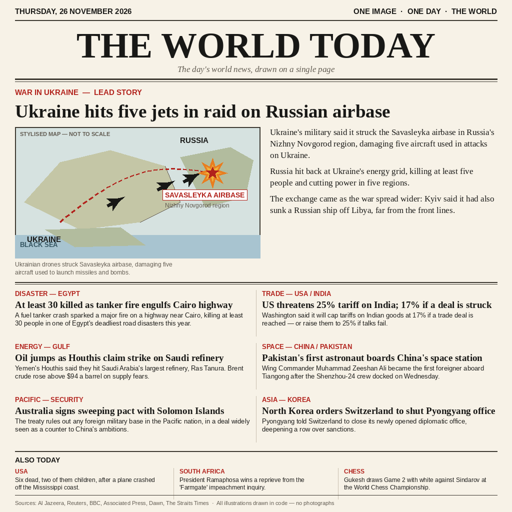

# World News in One Image — 26 November 2026

[](https://make.fun/competitions/news-image-20261126)
[](https://make.fun/competitions/news-image-20261126)
[](https://make.fun/competitions/news-image-20261126)

A single-page newspaper front page — **"THE WORLD TODAY"** — that sums up
Thursday 26 November 2026 in one 1024×1024 image. Every illustration is
drawn in code (Pillow); there are no photographs.



## The news in the image

**Lead story — War in Ukraine.** Ukraine's military said it struck the
Savasleyka airbase in Russia's Nizhny Novgorod region, damaging five
aircraft used to launch missiles and bombs. Russia hit back at Ukraine's
energy grid, killing at least five people and cutting power in five
regions. The war also spread wider: Kyiv said it had sunk a Russian ship
off Libya, far from the front lines. *(Al Jazeera, 26 Nov 2026)*

**The other stories:**

- **Disaster — Egypt.** A fuel tanker crash sparked a major fire on a
  highway near Cairo, killing at least 30 people.
- **Trade — USA / India.** The US said it will cap tariffs on Indian goods
  at 17% if a trade deal is reached — or raise them to 25% if talks fail.
  *(Reuters, 25–26 Nov 2026)*
- **Energy — Gulf.** Yemen's Houthis said they hit Saudi Arabia's largest
  refinery, Ras Tanura; Brent crude rose above $94 a barrel on supply
  fears. *(Reuters, 26 Nov 2026)*
- **Space — China / Pakistan.** Wing Commander Muhammad Zeeshan Ali became
  the first foreigner aboard China's Tiangong space station after the
  Shenzhou-24 crew docked. *(Dawn, 25 Nov 2026)*
- **Pacific — Security.** Australia and Solomon Islands signed a sweeping
  treaty ruling out any foreign military base in the Pacific nation, a deal
  widely seen as a counter to China's ambitions. *(The Straits Times, 25 Nov 2026)*
- **Asia — Korea.** North Korea ordered Switzerland to close its newly
  opened diplomatic office in Pyongyang.

**Also today:** six dead, two of them children, after a plane crashed off
the Mississippi coast (BBC); South Africa's President Ramaphosa wins a
reprieve from the "Farmgate" impeachment inquiry; Gukesh draws Game 2 with
white against Sindarov at the World Chess Championship.

Sources: Al Jazeera, Reuters, BBC, Associated Press, Dawn, The Straits Times.

## How it works

- `render.py` — renders the front page with Python + Pillow
  (masthead, lead story with a hand-drawn stylised map of the Savasleyka
  strike, six-story grid, "Also Today" strip). Output: `entry.png`
  (1024×1024, ≤ 1 MiB).
- `main.ts` — copies the validated `entry.png` to `/output/entry.png`.
  Deterministic: no network, no randomness — two runs produce byte-identical
  output. Before copying, it validates the PNG (signature, IHDR, full chunk
  chain through IEND, 1024×1024, ≤ 1 MiB) and fails with a clear error if
  the image is damaged.

## Run it

```bash
python3 render.py        # regenerate entry.png (1024x1024)
node main.ts             # writes /output/entry.png
```

## License

MIT — see [LICENSE](LICENSE).
